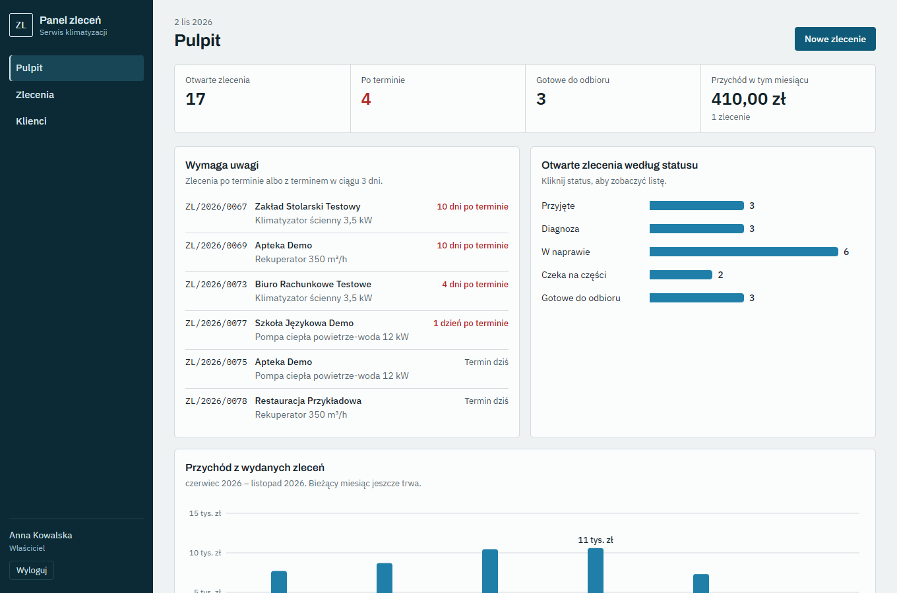

# Panel zleceń

Aplikacja webowa do prowadzenia zleceń w małej firmie serwisowej: przyjęcie zgłoszenia, przydział serwisanta, statusy, terminy, historia zmian, klienci i przychód.

To projekt demonstracyjny. Firma i dane są fikcyjne, a aplikacja nie jest wdrożeniem u klienta.



## Co potrafi

- Logowanie z dwiema rolami. Właściciel widzi przychód i może usuwać zlecenia, a serwisant nie.
- Pulpit: otwarte zlecenia, zlecenia po terminie, gotowe do odbioru, przychód z 6 miesięcy.
- Lista zleceń z wyszukiwarką, filtrami, sortowaniem, stronicowaniem i eksportem CSV dla Excela.
- Karta zlecenia z dozwolonymi zmianami statusu, notatkami i pełną historią.
- Numeracja zleceń rok po roku, np. `ZL/2026/0142`.
- Baza klientów z historią zleceń.
- Widok na telefonie i tryb ciemny.

## Technologie

| Warstwa | Użyte narzędzia |
|---|---|
| Interfejs | React 18, React Router, Vite, własny CSS |
| Serwer | Node.js, Express |
| Baza danych | SQLite (better-sqlite3), SQL pisany ręcznie |
| Walidacja | Zod, te same reguły w przeglądarce i na serwerze |
| Testy | `node:test` dla API, Playwright dla przeglądarki |

## Uruchomienie

Potrzebny jest Node.js 22.9 lub nowszy.

```powershell
npm install
Copy-Item .env.example .env
npm run seed
npm run dev
```

Aplikacja działa wtedy pod adresem <http://localhost:5173>. Konta testowe wypisuje `npm run seed`, a hasło jest w pliku `.env`.

Wersja produkcyjna, serwowana przez jeden serwer pod <http://localhost:3001>:

```powershell
npm run build
npm start
```

## Wersja demo bez serwera

`npm run build:demo` tworzy jeden plik `dist-demo/index.html`, który działa bez serwera na danych w pamięci przeglądarki. Można go otworzyć z dysku albo umieścić na darmowym hostingu statycznym. Eksport CSV jest w nim wyłączony, a zmiany znikają po odświeżeniu.

## Testy

```powershell
npm test
npm run build
npm run build:demo
npm run e2e
```

- `npm test` sprawdza API: logowanie, role, walidację, statusy, numerację, wyszukiwanie, terminy i CSV.
- `npm run e2e` przechodzi główne ścieżki w zainstalowanej przeglądarce Microsoft Edge, sprawdza widok na telefonie i zapisuje zrzuty ekranu w `docs/`.

Na GitHubie testy API uruchamiają się przy każdym wypchnięciu kodu, a wersja demo publikuje się potem na GitHub Pages.

## Rozwiązania, które warto znać

- **Kwoty w groszach.** Baza trzyma liczby całkowite, więc nie ma błędów zaokrągleń.
- **Terminy w czasie polskim.** „Po terminie” i przychód miesiąca liczą się według daty w Warszawie, a nie UTC.
- **Polskie wyszukiwanie.** `LIKE` w SQLite rozróżnia wielkość liter poza ASCII, więc baza ma własną funkcję `pl_lower`, dzięki której „łucja” znajduje „Łucja”.
- **Bezpieczeństwo.** Zapytania SQL są parametryzowane, hasła haszowane przez scrypt, sesje w ciasteczku `HttpOnly` i `SameSite=Strict`, a próby logowania ograniczone.
- **CSV odporny na formuły.** Komórki zaczynające się od `=`, `+`, `-` lub `@` są zabezpieczone, żeby Excel ich nie wykonał.

## Struktura

```text
client/   interfejs React
server/   API, baza danych i dane testowe
shared/   statusy, walidacja, daty i kwoty używane po obu stronach
tests/    testy API
e2e/      test w przeglądarce
docs/     zrzuty ekranu
```
